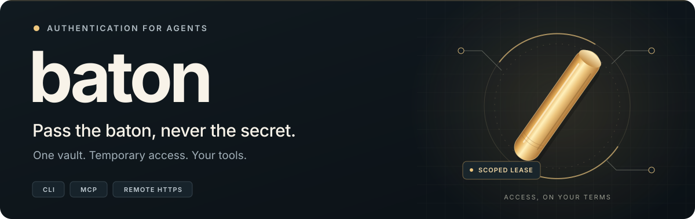
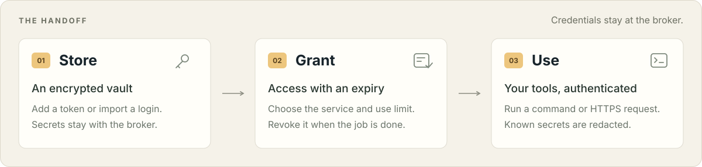

<div align="center">



<p>
  <a href="https://github.com/DanDekker/baton/actions/workflows/package.yml"></a>
  <a href="https://pypi.org/project/baton-auth/"></a>
  <a href="https://pypi.org/project/baton-auth/"></a>
</p>

<p><a href="#try-it">Try it</a> &nbsp;·&nbsp; <a href="#how-it-works">How it works</a> &nbsp;·&nbsp; <a href="#hand-work-to-another-agent">Remote agents</a> &nbsp;·&nbsp; <a href="https://github.com/DanDekker/baton/blob/main/docs/guide.md">User guide</a> &nbsp;·&nbsp; <a href="https://github.com/DanDekker/baton/blob/main/docs/security.md">Security</a></p>

</div>

**One place for the credentials your agents need.** Baton is a local auth broker for AI agents and MCP tools. It runs commands and API requests with the right credentials, then redacts known secrets from what comes back.

## How it works

<picture>
  <source media="(max-width: 640px)" srcset="https://raw.githubusercontent.com/DanDekker/baton/main/assets/baton-flow-mobile.svg">
  
</picture>

A **credential** is a saved token, password, or key. A **context** bundles the credentials for a job. A **lease** gives an agent temporary access, limited by service, expiry, and use count.

## Try it

Requires Python 3.10+ and [uv](https://docs.astral.sh/uv/).

```bash
uv tool install baton-auth

baton add github                    # prompts privately for your token
baton run github -- gh api /user     # use it through your existing CLI
baton http https://api.github.com/user

baton setup --auto                  # connect detected MCP clients
```

Already signed in? `baton import` imports supported local logins, including GitHub, AWS, and npm. Commands run in your working directory with a temporary `HOME` containing the permitted CLI settings.

### Give an agent a short-lived pass

```bash
lease=$(baton lease new github --ttl 600 --uses 20)
baton run "$lease" -- gh api /user
```

Revoke access with `baton lease revoke LEASE_ID`. See the [user guide](https://github.com/DanDekker/baton/blob/main/docs/guide.md) for contexts, service limits, and credential refresh.

<details>
<summary><strong>Connect your client</strong></summary>

`baton setup --auto` detects Cursor, Claude Desktop, Windsurf, Zed, VS Code, Muse Code, and Hermes Agent. You can also choose a client:

```bash
baton setup --client codex
baton setup --client claude-code
baton setup --client cursor
```

For another MCP client, `baton setup` prints portable config JSON. Agents with command access can use `baton run` and `baton http` directly. [Setup details →](https://github.com/DanDekker/baton/blob/main/docs/guide.md#connect-an-mcp-client)

</details>

## Hand work to another agent

Pair agents on different machines with one broker. Each keeps its own private key; credentials stay at the broker. An agent accepts a grant, uses the permitted HTTPS APIs, and can pass narrower access plus a task summary to another paired agent.

**[Set up remote pairing and handoffs →](https://github.com/DanDekker/baton/blob/main/docs/remote.md)**

Remote access is for HTTPS APIs. Shell commands and credential administration stay local.

<details>
<summary><strong>Under the hood</strong></summary>

| Purpose | Construction |
| --- | --- |
| Encrypted credentials | AES-256-GCM-SIV, with a ChaCha20-Poly1305 fallback |
| Key derivation, authentication, and audit chain | BLAKE3 |
| Passphrase-derived vault keys | Argon2id |
| AWS request signing | HMAC-SHA-256 / Signature Version 4 |

The vault stays on the broker machine. A temporary `HOME` separates CLI settings; it is not a full operating-system sandbox. Redaction covers known values and token patterns, not every possible encoding. [Security and limits →](https://github.com/DanDekker/baton/blob/main/docs/security.md)

</details>

---

[User guide](https://github.com/DanDekker/baton/blob/main/docs/guide.md) · [Security and limits](https://github.com/DanDekker/baton/blob/main/docs/security.md) · [Remote guide](https://github.com/DanDekker/baton/blob/main/docs/remote.md) · [Releases](https://github.com/DanDekker/baton/releases)

Package: `baton-auth` · Command: `baton` (or `baton-auth`) · Python: `baton_auth`
